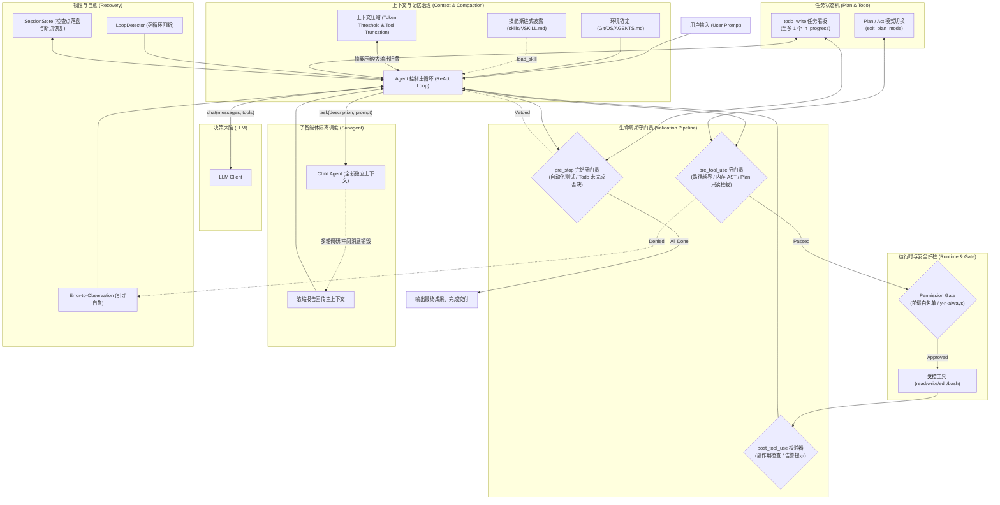

# 从第一性原理构建 Coding Agent (`Agent = LLM + Harness`)

[](https://www.python.org/downloads/)
[](LICENSE)
[](#运行单元测试)

本项目从零出发，**仅使用 Python 标准库与官方 OpenAI SDK**（不依赖 LangChain / LlamaIndex / AutoGen 等高层黑盒框架），分 **9 个独立可运行的演进步骤**，亲手构建一个工业级思想的精简版 **Claude Code**。

直观揭示：**大模型（LLM）本身只是一个无状态的 Next-token 预测器，真正赋予其工程生产力与安全边界的是包裹在外部的马具（Harness）。**

> 📖 **推荐阅读**：详细架构拆解与与 Claude Code 工业级机制的双栏深度对比，请见 [从第一性原理构建 Coding Agent：9 步演进之旅与 Claude Code 深度对比 (docs/first-principles-agent-journey.md)](docs/first-principles-agent-journey.md)。

---

## 目录

- [核心架构全景图](#核心架构全景图)
- [9 步第一性原理演进路线图](#9-步第一性原理演进路线图)
- [与 Claude Code 机制深度对比速查](#与-claude-code-机制深度对比速查)
- [快速开始与运行体验](#快速开始与运行体验)
- [目录结构说明](#目录结构说明)

---

## 核心架构全景图



---

## 9 步第一性原理演进路线图

每一阶段均有其独立可运行的代码（`steps/step0X_*.py`）和配套测试（`tests/test_step0X_*.py`），**均支持免 Key 的离线演示模式（`--demo`）**：

| 步骤 | 核心模块 (`harness/`) | 独立运行脚本 (`steps/`) | 解决的第一性原理工程痛点 |
| :--- | :--- | :--- | :--- |
| **Step 1** | `llm.py`, `ui.py` | `python3 steps/step01_bare_loop.py --demo` | 裸 LLM 只会单轮一问一答，如何通过 `while` 循环与 `tool_calls` 实现多步自主思考与工具调用闭环？ |
| **Step 2** | `tool.py` | `python3 steps/step02_tools.py --demo` | 手写 JSON Schema 极易漂移，如何通过 `@tool` 函数签名反射生成 Schema，并装配 Claude Code 最核心的 `read/write/edit/bash` 四大基础工具？ |
| **Step 3** | `runtime.py` | `python3 steps/step03_runtime.py --demo` | 工具裸奔存在越权和拖垮风险，如何实现环境变量净室隔离、路径穿越隔离（`is_relative_to`）以及命令前缀级权限门禁（Permission Gate）？ |
| **Step 4** | `validation.py` | `python3 steps/step04_validation.py --demo` | 模型容易写语法错误代码或提前偷懒交卷，如何通过 `pre_tool_use`（内存 AST 预检）、`post_tool_use`、`pre_stop`（单测守门员）拦截错误？ |
| **Step 5** | `recovery.py` | `python3 steps/step05_recovery.py --demo` | 真实执行易报错与陷入死循环，如何通过 Error-to-Observation 自愈、`LoopDetector`（连续重复调用阻断）、API 退避重试与会话状态机断点恢复（`--resume`）保障韧性？ |
| **Step 6** | `context.py`, `skills.py` | `python3 steps/step06_context_skills.py --demo` | 静态 Prompt 容易塞爆上下文，如何动态感知 Git/OS 环境与工作区 `AGENTS.md`，并通过 Progressive Disclosure（渐进式披露）按需展开 `skills/*/SKILL.md`？ |
| **Step 7** | `compaction.py` | `python3 steps/step07_compaction.py --demo` | 长对话逼近 Token 上限，如何在严格保证 `tool_calls` 配对不破坏 API 约束的前提下，实现工具大输出折叠与历史上下文自动摘要压缩？ |
| **Step 8** | `subagent.py`, `agent.py` | `python3 steps/step08_subagent_cli.py --demo` | 翻阅大量文件等探索性脏活会污染主对话记忆，如何通过 `task` 工具派发拥有全新独立上下文的 Subagent，并在其完成后销毁过程仅回传报告？ |
| **Step 9** | `todo.py` | `python3 steps/step09_plan_todo.py --demo` | 复杂任务容易“未想先改”或“半途而废”，如何实现 Plan/Act 双模态（规划期物理锁死写工具）与 `TodoWrite` 进度守门员（单一在办约束 + 完结拦截）？ |

---

## 与 Claude Code 机制深度对比速查

| 机制维度 | 本项目从第一性原理的极简实现 (`agent-impl2`) | 工业级产品实现 (`Anthropic Claude Code`) |
| :--- | :--- | :--- |
| **技术栈选择** | Python 3.10+ 标准库 + 官方 `openai` SDK，零重型框架 | TypeScript + Node.js + React Ink（用于富交互终端渲染） |
| **Schema 反射** | Python `inspect` 解析函数签名与类型注解自动生成 | TypeScript 类型推导结合 Zod Schema 运行时校验 |
| **代码编辑策略** | 精准单次字符串替换（`old_text` -> `new_text`，出现 0 次或多次则拒绝） | 同为精准唯一块替换策略（`old_string` / `new_string`），辅以 Diff 高亮预览 |
| **语法校验保护** | 在内存中对补丁后的 Python 代码运行 `ast.parse`，语法错误不落盘 | 基于 Tree-sitter / 各语言 LSP 对多语言进行增量语法错误检查 |
| **环境与技能管理** | 扫描 `skills/*/SKILL.md` 的 Frontmatter，通过 `load_skill` 按需加载 | 原生支持 Claude Code Skills 与 `CLAUDE.md`，按需上下文注入 |
| **子智能体调度** | `task` 工具：在相同沙盒下生成独立 `messages` 列表，销毁中间过程仅返回摘要 | 原生 Subagent 机制，内部唤起独立 Claude 探索实例，保护主任务记忆 |
| **规划执行双模态** | `make_plan_mode_pre_tool_hook` 在规划期拦截一切写操作，必须经 `exit_plan_mode` 解锁 | Architect / Plan 模式：只读探查，输出计划文档并等待确认后切换执行 |
| **任务看板与防偷懒** | `todo_write` 强约束至多 1 个 `in_progress`；`pre_stop` 钩子在有遗留待办时否决退出 | 原生 Todo 任务看板与执行进度跟踪，未完成任务禁止结束 |

---

## 快速开始与运行体验

### 1. 环境准备

本项目仅需 Python 3.10+（若安装了 `openai` SDK 则自动使用，若未安装会自动透明回退到标准库 `urllib.request` REST 调用）：

```bash
# 克隆仓库
git clone git@github.com:Sutonline/Agent-Impl-Study.git
cd Agent-Impl-Study

# 可选：配置真实模型 API Key（免 Key 也可通过 --demo 运行所有步骤）
cp .env.example .env
# 编辑 .env 填入你的 OPENAI_API_KEY 与 OPENAI_BASE_URL
```

### 2. 运行单元测试（全量自动化校验）

```bash
python3 -m unittest discover -s tests -v
```
*(全部 20 个测试用例均通过断言自动化验证各个模块的边界隔离、AST 拦截、重试退避、压缩截断与守门员行为)*

### 3. 免 Key 运行各步骤演示

每个步骤都可以独立运行观察其解决的核心问题：

```bash
# Step 1: 观察最小 while + tool_calls 循环
python3 steps/step01_bare_loop.py --demo

# Step 4: 观察越界访问、语法错误修改被 pre_tool_use 拦截，以及敷衍交卷被 pre_stop 拦截
python3 steps/step04_validation.py --demo

# Step 7: 观察长上下文被自动无损压缩为 <context_summary>
python3 steps/step07_compaction.py --demo

# Step 8: 观察子智能体在独立上下文调研并销毁过程消息
python3 steps/step08_subagent_cli.py --demo

# Step 9: 观察 Plan 模式写操作被物理锁死、制定 Todo 计划、以及提前交卷被完结守门员否决的全流程
python3 steps/step09_plan_todo.py --demo
```

### 4. 启动整合版 Mini Claude Code 交互式 CLI

```bash
# 启动终端交互 CLI
python3 steps/step08_subagent_cli.py

# 或者以只读 PLAN 规划模式启动
python3 steps/step08_subagent_cli.py --plan
```

支持的 CLI 指令：
* `/help`：显示帮助菜单
* `/skills`：列出当前检测到的 Skills
* `/compact`：立即手动触发上下文历史无损压缩
* `/session`：查看当前会话消息数与估算 Token
* `/todos`：查看当前 Todo 任务看板与执行模式
* `/plan` / `/act`：手动切换规划模式与执行模式
* `/quit`：退出程序

---

## 目录结构说明

```text
.
├── README.md                    # 本文件（项目主主页与学习路线图）
├── pyproject.toml               # 项目配置
├── .env.example                 # 环境变量模板
├── docs/
│   ├── first-principles-agent-journey.md  # 9 步演进之旅与 Claude Code 深度对比文档
│   └── superpowers/             # 原始设计 Spec 与 SDD 实施计划
├── harness/                     # 核心 Harness 引擎模块
│   ├── llm.py                   # [Step 1] LLM Client 与通用响应模型
│   ├── ui.py                    # [Step 1] 彩色终端日志打印
│   ├── tool.py                  # [Step 2] @tool 反射与四大基础工具集
│   ├── runtime.py               # [Step 3] 受控沙盒环境与前缀权限门禁
│   ├── validation.py            # [Step 4] 三段式生命周期校验管道 (Pre-Tool / Post-Tool / Pre-Stop)
│   ├── recovery.py              # [Step 5] 自愈容错、死循环检测与断点状态机
│   ├── context.py               # [Step 6] 运行时环境感知与动态 System Prompt
│   ├── skills.py                # [Step 6] 技能按需渐进式披露管理器
│   ├── compaction.py            # [Step 7] 输出折叠与保持配对的历史上下文压缩
│   ├── subagent.py              # [Step 8] 上下文隔离的 task 子智能体分发器
│   ├── todo.py                  # [Step 9] Plan/Act 双模态状态机与 TodoWrite 守门员
│   └── agent.py                 # 全套 Harness 能力整合而成的顶层 Agent 类
├── steps/                       # 9 个步骤的独立可执行脚本 (支持 --demo)
│   ├── step01_bare_loop.py
│   ├── step02_tools.py
│   ├── step03_runtime.py
│   ├── step04_validation.py
│   ├── step05_recovery.py
│   ├── step06_context_skills.py
│   ├── step07_compaction.py
│   ├── step08_subagent_cli.py
│   └── step09_plan_todo.py
├── tests/                       # 覆盖全部 9 个步骤的单元测试套件
│   ├── test_step01_loop.py ~ test_step09_plan_todo.py
├── skills/                      # 示例 Skills (code-reviewer, tdd-helper)
└── workspace/                   # Agent 操作的默认安全工作区
```

---
*本项目完全遵循第一性原理设计与实现。欢迎 Star 与参与探讨！*
