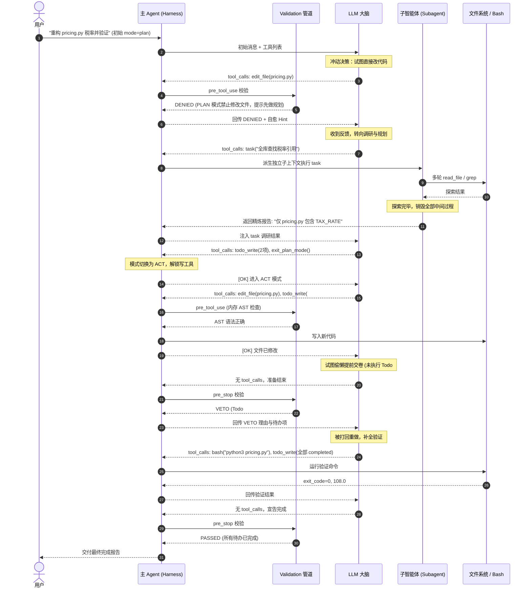

# 从第一性原理构建 Coding Agent：9 步演进之旅与 Claude Code 深度对比

> **核心哲学**：`Agent = LLM + Harness`  
> LLM（大脑）本质是一个无状态的 Next-token 预测器；Harness（马具）是赋予它手脚、安全边界、容错自愈、上下文记忆与多阶段任务规划的控制系统。

---

## 目录

- [一、宏观全景：Agent 整体架构图](#一宏观全景agent-整体架构图)
- [二、全生命周期时序图（Plan -> Subagent -> Act -> Gatekeeper）](#二全生命周期时序图)
- [三、九步演进历程与机制拆解](#三九步演进历程与机制拆解)
- [四、双栏深度对比：我们的实现 vs Claude Code 生产级实现](#四双栏深度对比我们的实现-vs-claude-code-生产级实现)
- [五、第一性原理思考与工程启示](#五第一性原理思考与工程启示)

---

## 一、宏观全景：Agent 整体架构图

在本项目中，我们剥离了任何黑盒高层框架（无 LangChain / LlamaIndex / AutoGen），仅使用 Python 标准库与底层 API，逐层构建起以下内聚的 Harness 架构：

```mermaid
flowchart TD
    User["用户指令 (User Prompt)"] --> AgentLoop["Agent 控制主循环 (Agent Loop)"]
    
    subgraph HarnessContext["1. 上下文与记忆治理 (Context & Compaction)"]
        SysPrompt["环境锚定 (Git/OS/AGENTS.md)"] --> AgentLoop
        Skills["技能渐进式披露 (skills/*/SKILL.md)"] -.->|load_skill| AgentLoop
        Compactor["上下文压缩器 (Token Threshold & Tool Truncation)"] <-->|历史摘要/大输出折叠| AgentLoop
    end

    subgraph LLMDecider["2. 决策大脑 (LLM Engine)"]
        AgentLoop <-->|"chat(messages, tools)"| LLM["LLM Client (OpenAI API / REST Fallback)"]
    end

    subgraph ValidationHooks["3. 三段式生命周期校验 (Validation Pipeline)"]
        PreToolHook{"pre_tool_use 守门员<br/>(路径边界 / 内存 AST / Plan只读拦截)"}
        PostToolHook{"post_tool_use 校验器<br/>(副作用检查 / 告警提示)"}
        PreStopHook{"pre_stop 完结守门员<br/>(单测验证 / Todo 未完成否决)"}
    end

    subgraph RuntimeSandbox["4. 运行时与安全屏障 (Runtime & Gate)"]
        AgentLoop --> PreToolHook
        PreToolHook -->|Passed| PermGate{"Permission Gate<br/>(命令前缀拆解 / y-n-always)"}
        PermGate -->|Approved| ToolExec["受控工具执行 (read/write/edit/bash)"]
        ToolExec --> PostToolHook
        PostToolHook --> ToolResultMsg["结构化 Observation (Tool Result)"]
        ToolResultMsg --> AgentLoop
    end

    subgraph SubagentCluster["5. 隔离子智能体 (Subagent Dispatcher)"]
        AgentLoop -->|"task(description, prompt)"| ChildAgent["Child Agent<br/>(全新独立 messages 上下文)"]
        ChildAgent -.->|多轮调研结束/中间消息销毁| SummaryReport["浓缩报告回传主上下文"]
        SummaryReport --> AgentLoop
    end

    subgraph TaskStateManagement["6. 任务状态机 (Plan & Todo)"]
        TodoWrite["todo_write 看板<br/>(至多 1 个 in_progress)"] <--> AgentLoop
        PlanActSwitch["Plan / Act 模式切换<br/>(exit_plan_mode)"] <--> PreToolHook
        TodoWrite <--> PreStopHook
    end

    subgraph RecoverySystem["7. 韧性与自愈 (Recovery & Resilience)"]
        PreToolHook -.->|Denied / Failed| ErrObs["Error-to-Observation (注入自愈建议)"]
        ErrObs --> AgentLoop
        LoopDetector["LoopDetector (连续相同失败阻断)"] --> AgentLoop
        SessionStore["SessionStore (检查点落盘与断点恢复)"] <--> AgentLoop
    end

    AgentLoop --> PreStopHook
    PreStopHook -->|All Todos Completed & Tests Passed| FinalAnswer["输出最终成果，完成交付"]
    PreStopHook -.->|Vetoed (待办未完/测试失败)| AgentLoop
```

---

## 二、全生命周期时序图

下图展示了一个复杂任务中，Harness 是如何联动 **Plan 拦截**、**Subagent 上下文隔离**、**Act 模式修改** 以及 **Pre-Stop 完结守门员** 形成闭环的：



---

## 三、九步演进历程与机制拆解

本项目按照“痛点驱动 -> 引入 Harness 机制 -> 消除痛点”的演进脉络，分 9 步构建：

```
Step 01: The Loop (while + tool_calls)
   ↓ 痛点：手写 schema 脆弱，缺乏真实文件/执行能力
Step 02: Tools (@tool 反射 + read/write/edit/bash)
   ↓ 痛点：全局裸奔无边界，危险命令无审批
Step 03: Runtime & Gate (cwd 净室沙盒 + 前缀授权门禁)
   ↓ 痛点：参数易错、语法写挂、敷衍交卷
Step 04: Validation Pipeline (pre_tool / post_tool / pre_stop)
   ↓ 痛点：网络限流、死循环卡死、进程崩溃进度丢失
Step 05: Recovery & State (重试退避 + LoopDetector + 断点续跑)
   ↓ 痛点：上下文过载，系统提示词注意力分散
Step 06: Context & Skills (环境锚定 + SKILL.md 渐进式披露)
   ↓ 痛点：长对话撑爆 Token，工具超大输出截断
Step 07: Compaction (工具输出折叠 + 历史长文本自动摘要)
   ↓ 痛点：探索性脏活污染主上下文
Step 08: Subagent & CLI (task 独立上下文子智能体 + 完整 CLI)
   ↓ 痛点：未思先改代码、中途遗忘待办事项
Step 09: Plan & Todo Mode (Plan/Act 阶段隔离 + 进度守门员)
```

### 1. Step 01：裸 LLM 与最小控制循环（The Loop）
- **核心公式**：`while True: resp = llm.chat(msgs); if not resp.tool_calls: break; execute_tools()`。
- **意义**：迈出从“单轮对话聊天机器人”跨入“多步自主决策智能体”的第一步。

### 2. Step 02：工具系统与反射（Tools & Reflection）
- **实现**：通过 Python `inspect` 模块内省函数签名与 Type Hints，自动生成符合 OpenAI 规范的 Function JSON Schema；实现 `read_file`、`write_file`、`edit_file`（精确唯一块替换）与 `bash`。
- **意义**：消除了手写 JSON Schema 的沉重负担与参数漂移风险。

### 3. Step 03：运行时与权限门禁（Runtime & Permission Gate）
- **实现**：`AgentRuntime` 接管环境隔离、cwd 解析与路径边界防穿越（`is_relative_to`）。引入受控子进程（执行超时 `timeout` 与字符数硬截断）。基于命令拆解实现前缀级权限门禁（安全只读命令自动放行，破坏性操作弹出 `[y/n/always]`）。
- **意义**：建立沙盒底线，杜绝误执行 `rm -rf /` 或命令死锁拖垮宿主。

### 4. Step 04：三段式校验生命周期（Validation Pipeline）
- **实现**：定义统一接口 `ValidationResult(passed, reason, recovery_hint)`，在生命周期 3 个关键点插入 Hook：
  1. `pre_tool_use`：路径白名单校验、内存 AST 语法校验（改 Python 代码前在内存中 `ast.parse`，不通过绝不落盘）；
  2. `post_tool_use`：副作用复核；
  3. `pre_stop`：任务交卷前守门员（触发自动化测试命令，单测未过否决交卷）。
- **意义**：将原本散落的一堆硬编码校验解耦为高度可插拔的管道。

### 5. Step 05：自愈容错与状态机恢复（Recovery & Resilience）
- **实现**：
  1. **Error-to-Observation**：工具异常不抛崩主循环，格式化为包含诊断线索的文本反馈给 LLM；
  2. **LoopDetector**：哈希比对最近 $N$ 次工具调用签名，发现连续 3 次相同调用即注入警告打断死循环；
  3. **指数退避重试**：抗击 API 限流；
  4. **会话断点状态机（SessionStore）**：每轮原子落盘，支持进程被 kill 后通过 `--resume` 续跑，并能智能识别“工具执行中途崩溃”实现断点补跑。
- **意义**：让 Agent 具备了在恶劣环境下的自愈力与长期任务稳定性。

### 6. Step 06：环境锚定与技能渐进式披露（Context & Skills）
- **实现**：自动感应宿主 OS、cwd、git 状态以及读取工作区 `AGENTS.md` 注入常驻 System Prompt。通过类似 Claude Code 的渐进式披露（Progressive Disclosure），初始仅注入技能名称与简要介绍，通过 `load_skill` 工具在需要时动态展开加载详细规程。
- **意义**：大幅削减初始 Prompt 冗余 Token，提升模型注意力聚焦度。

### 7. Step 07：上下文无损压缩治理（Compaction）
- **实现**：
  1. **大输出折叠**：单次工具输出超长时，保留头尾关键信息、折叠中间并提示行数；
  2. **历史压缩（Auto-Compaction）**：Token 超过阈值时，保留 System 设定与最近 $K$ 轮消息，早期漫长历史调用 LLM 浓缩为 `<context_summary>`。严格保持 `assistant` 的 `tool_calls` 与对应 `tool` 结果紧密配对，杜绝出现 OpenAI API 孤儿消息报错（400 Error）。
- **意义**：突破单次对话的 Token 长度天花板，支持数小时长效对话。

### 8. Step 08：隔离子智能体与综合 CLI（Subagent & Full CLI）
- **实现**：引入 `task(description, prompt)` 工具。派生具有完全隔离 `messages` 上下文的 Child Agent，子 Agent 跑完多轮深度代码探索后，将全部过程消息销毁，仅回传浓缩结论给主 Agent。
- **意义**：防止“探索性脏活”污染主上下文窗口，实现上下文的干净分离。

### 9. Step 09：Plan/Act 双模式与 Todo 完结守门员（Plan & Todo Mode）
- **实现**：
  1. **Plan 阶段拦截**：挂载 `make_plan_mode_pre_tool_hook`，在 `plan` 模式下严禁一切修改与破坏性动作，逼迫 LLM 先调研并用 `todo_write` 制定步骤，调用 `exit_plan_mode` 切换模式；
  2. **单一进行中约束**：同一时刻至多 1 个 Todo 处于 `in_progress`；
  3. **Todo 完结守门员**：挂载 `make_todo_pre_stop_hook`，存在未完成待办项时严禁交卷。
- **意义**：消灭“盲目改代码”与“半途而废”，实现可控、有序的结构化交付。

---

## 四、双栏深度对比：我们的实现 vs Claude Code 生产级实现

| 机制维度 | 本项目从第一性原理的极简实现 (`agent-impl2`) | 工业级产品实现 (`Anthropic Claude Code`) | 异同与本质思考 |
| :--- | :--- | :--- | :--- |
| **编程语言与运行时** | **Python 3.10+**<br>零三方大框架，仅依赖标准库 + 官方 `openai` SDK | **TypeScript / Node.js**<br>通过 React Ink 构建富终端交互与事件流系统 | 语言不同，但内部 Harness 的状态机架构完全同构。Python 极简便于学习算法本质，TS 便于打包单体 npm CLI。 |
| **主控制循环 (The Loop)** | 显式 `while True` 循环，直接处理 `tool_calls` 数组并同步执行分发。 | 反应式异步事件流（Event-driven Streaming Loop），支持流式 Tool Call 边生成边解析。 | 本项目强调状态转换直观可见，Claude Code 针对打字机式流式体验做了更复杂的异步流处理。 |
| **工具定义与 Schema 反射** | 使用 `@tool` 装饰器通过 Python `inspect.signature` 解析 Type Hints 生成 OpenAI Schema。 | 基于 TypeScript 类型与 Zod Schema 运行时校验（`z.object({...})`）。 | 本质相同：都拒绝手写 JSON Schema，通过代码类型系统自动反射出 Schema，杜绝漂移。 |
| **编辑工具实现 (`edit_file`)** | 精确单次字符串匹配替换（`old_text` -> `new_text`），若匹配出现 0 次或多次则安全拒绝。 | 同为精准唯一块替换（`old_string` / `new_string` 策略），辅以 Diff 高亮显示。 | 二者均未采用脆弱的“行号替换”或让模型重写整个文件，而是采用业界验证最稳定的精确文本补丁策略。 |
| **权限审批门禁 (Permission Gate)** | 解析 Bash 命令前缀，建立白名单自动放行；危险命令拦截弹出 `[y/n/always]` 询问。 | 基于命令 AST 解析器（如 `bash-parser`）分析可执行程序，支持 `auto-approve`、会话级授权。 | 本项目自建轻量级命令分割与前缀提取；Claude Code 在 AST 层做更严密的子 Shell 与管道命令穿透分析。 |
| **代码语法预检 (AST Check)** | 在内存中对编辑后的 Python 代码执行 `ast.parse()`，发现 `SyntaxError` 阻断写入。 | 集成 Tree-sitter / 各语言 LSP 对 TS/JS/Python/Rust 等多语言进行增量语法错误检查。 | 原理一致：利用语法解析器在“代码真正落盘前”拦截低级拼写和语法错误。 |
| **容错自愈 (Recovery)** | **Error-to-Observation**：格式化错误与 Hint。<br>**LoopDetector**：3次相同调用签名判定并警告。 | 包含更丰富的智能错误重试、API 限流排队重试、模型自动降级以及重复工具循环打断。 | 核心原则一致：把错误当作模型的 Observation 喂回给它，让其自己纠错，而不是让 Python 抛崩溃退出。 |
| **技能机制 (Skills)** | 扫描 `skills/*/SKILL.md` 的 Frontmatter；System Prompt 仅给索引，`load_skill` 动态展开。 | 原生支持 Claude Code Skills / Rules（`.claude/skills` 或 `CLAUDE.md`），基于关键词动态激活。 | 完全一致：采用 Progressive Disclosure（渐进式披露）大幅降低上下文冗余。 |
| **上下文压缩 (Compaction)** | 大输出折叠（保留首尾）+ 超过阈值后 LLM 总结历史为 `<context_summary>`，严保 Tool 配对。 | 原生 Compact 算法，折叠长工具调用结果，自动触发对话截断压缩并重构系统摘要。 | 严格配对原则是共通的：OpenAI 与 Claude 的 API 均严禁将 Assistant 的 tool_calls 与 Tool 回复拆开。 |
| **子智能体 (Subagent)** | 提供 `task` 工具，克隆环境沙盒但给予独立新 `messages`，跑完仅向主 Agent 回传最终结果。 | 原生 Subagent（通过内部调度器唤起专注子任务的 Claude 实例，如代码搜索、测试排查）。 | 完全一致：用隔离的上下文窗口隔离噪音，防止“探索性遍历”破坏主任务上下文。 |
| **阶段隔离 (Plan/Act)** | `make_plan_mode_pre_tool_hook` 在 `pre_tool_use` 拦截写操作，直到 `exit_plan_mode`。 | Claude Code 的 `Architect` / `Plan` 模式：只读探查，输出计划文档并获得用户批准后切入执行。 | 机制完全一致：通过生命周期拦截器阻断写动作，消除“未思先改”的冲动型错误。 |
| **任务看板 (TodoWrite)** | `todo_write` 维护列表，限制至多 1 个 `in_progress`；`pre_stop` 钩子在有遗留任务时否决退出。 | Claude Code 原生待办清单与进度指示器，督导多步骤执行完成度。 | 机制完全一致：利用状态机约束线性注意力，并通过交卷守门员拦截敷衍了事的提前退出。 |

---

## 五、第一性原理思考与工程启示

通过亲手构建整个 Harness，我们提炼出三条最高工程准则：

1. **绝对不要相信大模型的“自觉性”，必须构建代码级硬隔离**
   - 试图在 Prompt 里用大写英文写 `DO NOT MODIFY FILES BEFORE PLANNING` 是脆弱的；
   - 真正的健壮系统，必须是在 `pre_tool_use` 阶段返回 `ValidationResult(passed=False, status='denied')`，从物理上切断写权限。

2. **优雅的生命周期 Hook 管道胜过散落的 `if-else`**
   - 如果把权限检查、AST 检查、Plan 限制、测试检查全部写进各个工具函数或主循环里，系统将在第 4 步之后彻底腐化；
   - 将验证收敛为 `pre_tool_use`、`post_tool_use`、`pre_stop` 三个纯函数切面，后续的 Plan/Act、Todo、沙盒限制都能以插件形式无缝接入。

3. **复杂任务治理的两大银弹：阶段隔离 (Phase) 与上下文隔离 (Context)**
   - **阶段隔离（Plan/Act）**：把“想清楚”与“动手改”在时间轴上物理切开，解决空间理解错误；
   - **上下文隔离（Subagent）**：把“脏活调研过程”与“主线修改记录”在内存空间上物理切开，解决注意力退化。

---
*本文档由 [Agent-Impl-Study](https://github.com/Sutonline/Agent-Impl-Study) 项目第一性原理实战总结沉淀。*
