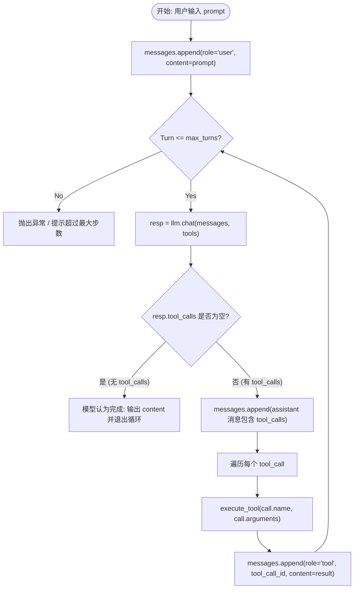
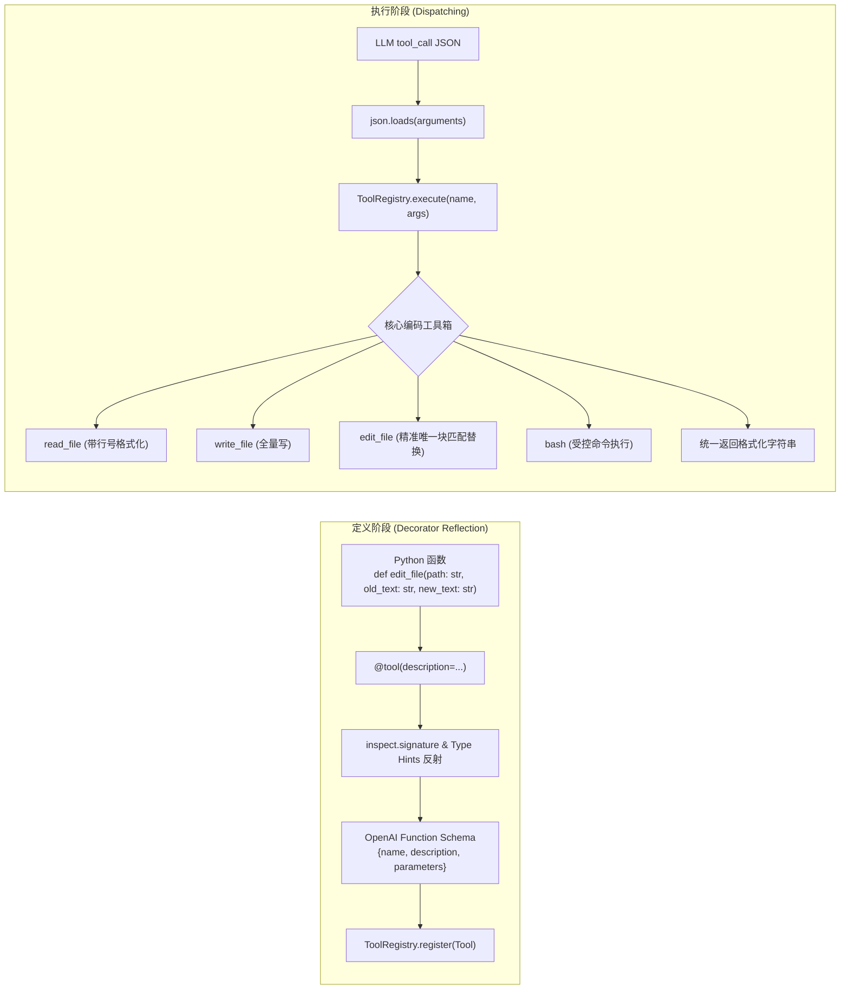
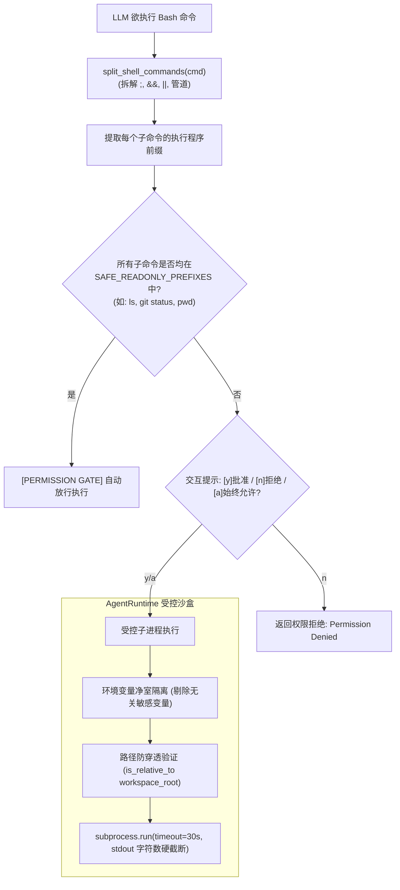
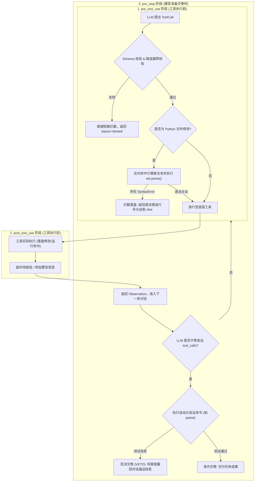
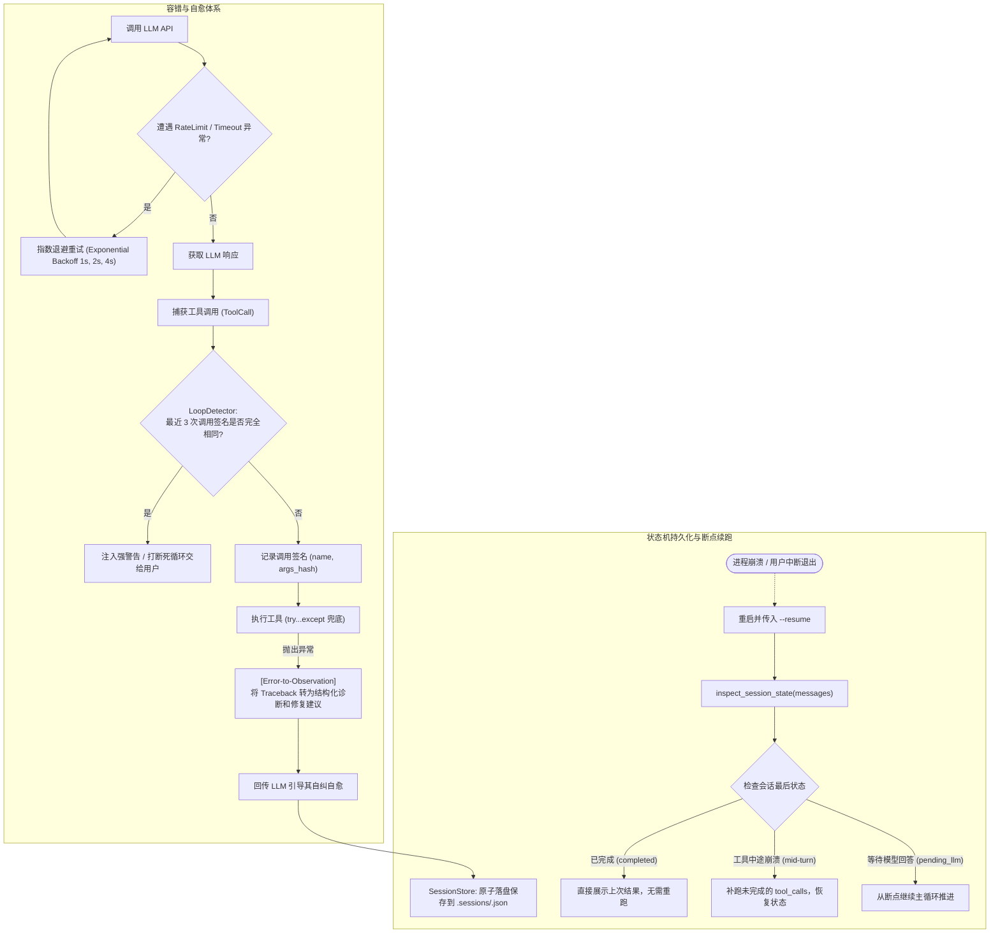
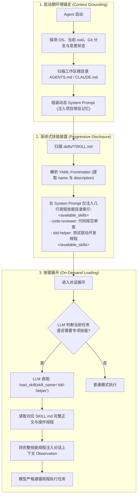
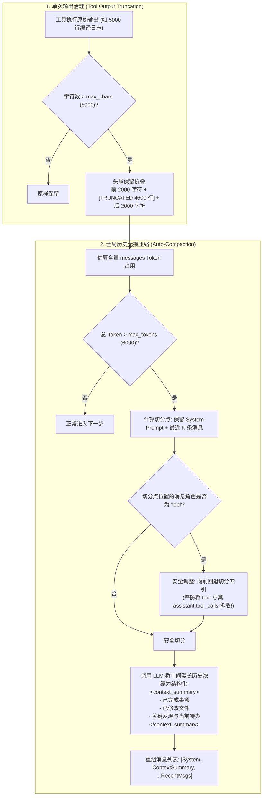
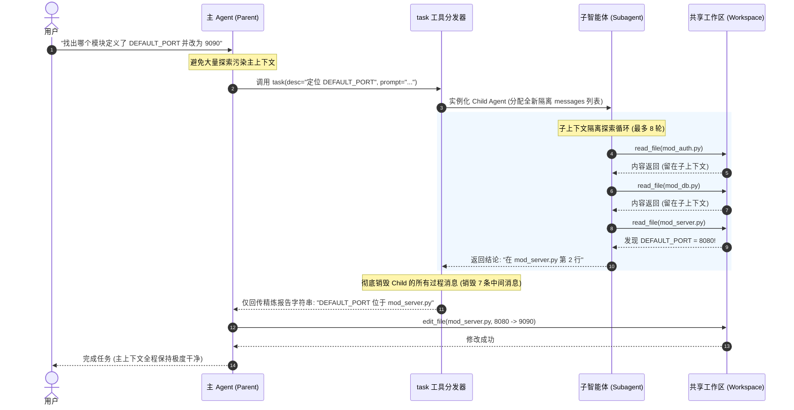
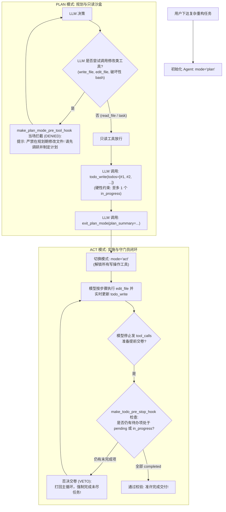

# 从第一性原理构建 Coding Agent：9 步逐层演进架构图与 Claude Code 工业级深度对比

> **核心哲学**：`Agent = LLM + Harness`  
> LLM（大脑）本质上只是一个无状态的 Next-token 概率预测器；Harness（马具）是包裹在其外层的工程骨架——为它装上四肢、沙盒边界、语法预检、异常自愈、记忆压缩、上下文隔离与多阶段规划状态机。

---

## 目录

- [宏观全景与核心架构总览](#宏观全景与核心架构总览)
- [Step 01：控制循环 (The Loop)](#step-01控制循环-the-loop)
- [Step 02：工具系统与反射 (Tools & Reflection)](#step-02工具系统与反射-tools--reflection)
- [Step 03：运行时与权限门禁 (Runtime & Permission Gate)](#step-03运行时与权限门禁-runtime--permission-gate)
- [Step 04：三段式校验生命周期 (Validation Pipeline)](#step-04三段式校验生命周期-validation-pipeline)
- [Step 05：容错自愈与会话状态机 (Recovery & Session State)](#step-05容错自愈与会话状态机-recovery--session-state)
- [Step 06：环境锚定与技能按需展开 (Context & Skills)](#step-06环境锚定与技能按需展开-context--skills)
- [Step 07：上下文无损压缩治理 (Compaction)](#step-07上下文无损压缩治理-compaction)
- [Step 08：隔离子智能体与综合 CLI (Subagent & Full CLI)](#step-08隔离子智能体与综合-cli-subagent--full-cli)
- [Step 09：Plan/Act 双模式与 Todo 完结守门员 (Plan & Todo Mode)](#step-09planact-双模式与-todo-完结守门员-plan--todo-mode)
- [总结与核心启示](#总结与核心启示)

---

## 宏观全景与核心架构总览

在本项目中，我们完全摒弃高层封装黑盒（无 LangChain / LlamaIndex / AutoGen），仅使用 Python 标准库与官方 API，逐层构建起以下内聚的 Harness 系统：

```mermaid
flowchart TD
    User["用户指令 (User Prompt)"] --> AgentLoop["Agent 控制主循环 (ReAct Loop)"]
    
    subgraph ContextCompaction["1. 上下文与记忆治理 (Context & Compaction)"]
        SysPrompt["环境快照 (Git/OS/AGENTS.md)"] --> AgentLoop
        Skills["技能渐进式披露 (skills/*/SKILL.md)"] -.->|load_skill| AgentLoop
        Compactor["上下文压缩器 (Token Threshold & Tool Truncation)"] <-->|历史摘要/大输出折叠| AgentLoop
    end

    subgraph LLMDecider["2. 决策大脑 (LLM Engine)"]
        AgentLoop <-->|"chat(messages, tools)"| LLM["LLM Client (OpenAI API / REST Fallback)"]
    end

    subgraph ValidationHooks["3. 三段式生命周期校验 (Validation Pipeline)"]
        PreToolHook{"pre_tool_use 守门员<br/>(路径边界 / 内存 AST / Plan只读拦截)"}
        PostToolHook{"post_tool_use 校验器<br/>(副作用检查 / 告警提示)"}
        PreStopHook{"pre_stop 完结守门员<br/>(单测验证 / Todo 未完成否决)"}
    end

    subgraph RuntimeSandbox["4. 运行时与安全屏障 (Runtime & Gate)"]
        AgentLoop --> PreToolHook
        PreToolHook -->|Passed| PermGate{"Permission Gate<br/>(命令前缀拆解 / y-n-always)"}
        PermGate -->|Approved| ToolExec["受控工具执行 (read/write/edit/bash)"]
        ToolExec --> PostToolHook
        PostToolHook --> ToolResultMsg["结构化 Observation (Tool Result)"]
        ToolResultMsg --> AgentLoop
    end

    subgraph SubagentCluster["5. 隔离子智能体 (Subagent Dispatcher)"]
        AgentLoop -->|"task(description, prompt)"| ChildAgent["Child Agent<br/>(全新独立 messages 上下文)"]
        ChildAgent -.->|多轮调研结束/中间消息销毁| SummaryReport["浓缩报告回传主上下文"]
        SummaryReport --> AgentLoop
    end

    subgraph TaskStateManagement["6. 任务状态机 (Plan & Todo)"]
        TodoWrite["todo_write 看板<br/>(至多 1 个 in_progress)"] <--> AgentLoop
        PlanActSwitch["Plan / Act 模式切换<br/>(exit_plan_mode)"] <--> PreToolHook
        TodoWrite <--> PreStopHook
    end

    subgraph RecoverySystem["7. 韧性与自愈 (Recovery & Resilience)"]
        PreToolHook -.->|Denied / Failed| ErrObs["Error-to-Observation (注入自愈建议)"]
        ErrObs --> AgentLoop
        LoopDetector["LoopDetector (连续相同失败阻断)"] --> AgentLoop
        SessionStore["SessionStore (检查点落盘与断点恢复)"] <--> AgentLoop
    end

    AgentLoop --> PreStopHook
    PreStopHook -->|All Todos Completed & Tests Passed| FinalAnswer["输出最终成果，完成交付"]
    PreStopHook -.->|Vetoed (待办未完/测试失败)| AgentLoop
```

---

## Step 01：控制循环 (The Loop)

### 1. 解决的痛点
裸 LLM 只是单轮问答模型，面对“查看报错并修复代码”的多步任务时无法自主推进。必须让模型在每一步决定是调用工具还是得出最终答案。

### 2. 步骤架构图



### 3. 本步最小实现
- 模块：[`harness/llm.py`](file:///opt/docs/study/agent-impl2/harness/llm.py)、[`steps/step01_bare_loop.py`](file:///opt/docs/study/agent-impl2/steps/step01_bare_loop.py)
- 代码通过纯 `while True` 循环，一旦检测到 `response.tool_calls` 为空则代表 LLM 给出最终回答并退出；若有工具调用，执行并拼装 `role='tool'` 的消息回传。

### 4. 我们当下的最小实现存在的问题
1. **同步全量阻塞，无流式打字机效果（Streaming）**：用户必须干等几十秒直到模型完整吐出 Token，首字延迟（TTFT）与体验极差。
2. **缺乏异步中断控制（AbortController）**：若模型陷入胡思乱想或调错工具，用户在终端无法通过 Ctrl+C 优雅打断单步生成并保留已有上下文。
3. **工具调用纯串行**：如果模型在一轮中同时返回 5 个 `read_file` 调用，最小实现只能一个接一个同步读取，总延迟呈线性叠加。

### 5. Claude Code 是如何做的
- **反应式流式事件驱动（Reactive Streaming Loop）**：Claude Code 使用 Server-Sent Events (SSE) 流式传输。在模型生成 `thought` 和 `tool_use` JSON 片段时，终端以打字机模式实时渲染 Markdown。
- **动态 JSON 片段流式解析器**：在工具参数未完全传输完成前，就开始预热和校验工具参数。
- **并发只读工具调度**：对无副作用的工具（如并行读取 10 个文件、多个 glob 匹配），Claude Code 内部使用 `Promise.all` 异步并发执行，耗时从几秒降至几百毫秒。
- **精细中断状态保留**：监听 SIGINT，中断时捕获已生成的 partial 状态，写入历史消息并让用户接管。

---

## Step 02：工具系统与反射 (Tools & Reflection)

### 1. 解决的痛点
Step 1 中手写 JSON Schema 繁琐且容易与 Python 函数实现脱节；同时 Agent 缺少真正操作工程代码的“手”与“眼”。

### 2. 步骤架构图



### 3. 本步最小实现
- 模块：[`harness/tool.py`](file:///opt/docs/study/agent-impl2/harness/tool.py)、[`steps/step02_tools.py`](file:///opt/docs/study/agent-impl2/steps/step02_tools.py)
- `@tool` 利用 Python `inspect.signature` 解析参数名、类型与默认值，自动生成符合 OpenAI 规范的 Schema；
- 实现 Claude Code 核心的 4 个工具：`read_file`、`write_file`、`edit_file`（精确单次替换）、`bash`。

### 4. 我们当下的最小实现存在的问题
1. **`edit_file` 过于机械**：强制要求 `old_text` 与目标文件内容 100% 字节精确匹配。如果大模型输出时多了一个空格、Tab 缩进不同或少了一个换行符，直接报错拒绝，容错率低。
2. **`read_file` 易爆内存与 Token**：一次性读入全文件。如果遇到 2 万行的日志或编译产物，会导致上下文直接爆满。
3. **缺少语义搜索与代码拓扑感知工具**：只有 `bash` 和 `read_file`，缺少类似 Ripgrep、AST 符号索引等专用代码搜索工具。

### 5. Claude Code 是如何做的
- **带容错与归一化的编辑算法**：Claude Code 的 `Edit` 工具在匹配时会进行空白符规范化（Whitespace Normalization）、缩进自适应与唯一候选模糊匹配；同时输出清晰的 Git 统一 Diff（带彩色增删行对比），供用户或模型复核。
- **强制分页与智能窗口切片**：其 `FileRead` 工具强制支持 `offset` 和 `limit`，并在读取大文件时主动截断并提示模型“如需查看后续内容请指定行号区间”。
- **专用高效工具矩阵**：原生集成 `GrepTool`（底层基于编译级 ripgrep）、`GlobTool`（快速文件树扫描）、`NotebookEditTool`（专门处理 Jupyter 单元格）。

---

## Step 03：运行时与权限门禁 (Runtime & Permission Gate)

### 1. 解决的痛点
工具裸跑在全局环境极易造成越权访问（如访问 `../` 越出代码库或修改系统敏感配置），危险命令（如 `rm -rf`）缺少人工审批防线。

### 2. 步骤架构图



### 3. 本步最小实现
- 模块：[`harness/runtime.py`](file:///opt/docs/study/agent-impl2/harness/runtime.py)、[`steps/step03_runtime.py`](file:///opt/docs/study/agent-impl2/steps/step03_runtime.py)
- `AgentRuntime` 统一管理 `workspace_root`，使用 `Path.resolve().is_relative_to(...)` 防止路径穿越；
- `PermissionGate` 拆分复合命令，对只读命令自动放行，对危险写操作弹出 `[y/n/always]` 审批；
- 子进程受 `timeout` 和输出最大字符数保护。

### 4. 我们当下的最小实现存在的问题
1. **简单的 Shell 字符串拆解容易被语法绕过**：通过环境变量前置（`FOO=bar rm -rf`）、嵌套子 Shell（`echo $(rm -rf /)`）或反引号命令替换，正则前缀提取可能失效。
2. **缺乏内核级硬沙盒隔离**：子进程依然直接运行在宿主 OS 上，命令如果访问 `~/.ssh` 或全局网络端口，无法从操作系统层直接拦截。
3. **权限颗粒度粗糙**：只有“放行”与“禁止”，无法限制网络访问（如禁止 curl 外部不可信 IP）。

### 5. Claude Code 是如何做的
- **基于真实 AST 的 Shell 语法解析**：Claude Code 使用完整的 `bash-parser` 生成命令语法树，递归遍历所有 AST 节点（Command, Subshell, Pipe, Redirect, EnvAssign），杜绝任何语法逃逸。
- **系统级沙盒容器（OS-level Sandbox）**：在 macOS 上采用 `sandbox-exec`（Seatbelt 策略），在 Linux 上使用 `bubblewrap`（Namespaces 命名空间隔离），从内核级别屏蔽文件系统未授权路径写权限与网络外联。
- **细粒度权限策略配置**：支持 `.claude/config.json` 定义规则、持久化授权域名与目录级权限白名单。

---

## Step 04：三段式校验生命周期 (Validation Pipeline)

### 1. 解决的痛点
硬编码 `if/else` 校验容易导致主循环腐化；LLM 容易写出带语法错误的代码，或者修改完不跑测试就“交卷”。

### 2. 步骤架构图



### 3. 本步最小实现
- 模块：[`harness/validation.py`](file:///opt/docs/study/agent-impl2/harness/validation.py)、[`steps/step04_validation.py`](file:///opt/docs/study/agent-impl2/steps/step04_validation.py)
- 构建 `ValidationPipeline`，支持可插拔的 `pre_tool_use`、`post_tool_use`、`pre_stop` 钩子；
- 实现了内存 Python AST 预检（语法错误不落盘）与交卷测试守门员。

### 4. 我们当下的最小实现存在的问题
1. **语言单一**：AST 检查仅支持 Python（使用标准库 `ast`），对于 JS、TS、Rust、Go、Java 等语言无法进行内存语法预检。
2. **缺乏语义层与类型层检查（LSP 缺失）**：`ast.parse` 只能拦截基础的语法错，对于未导入包、变量未定义、类型不匹配等语义错误无能为力。
3. **单测守门员静态死板**：`pre_stop` 命令是写死的单条命令，无法智能识别本次改动了哪个文件进而只跑对应的最小相关测试集。

### 5. Claude Code 是如何做的
- **多语言通用 Tree-sitter AST**：集成 Tree-sitter，在内存中毫秒级解析数十种现代编程语言的语法树。
- **语言服务协议（LSP - Language Server Protocol）集成**：在改动代码后，自动向后端的 TypeScript / Pyright / Rust-analyzer LSP 请求增量 Diagnostics，直接抓取精准的类型错误和缺失引用。
- **智能测试影响面分析（Test Impact Analysis）**：结合 Git 变更树，自动匹配关联的单元测试文件，避免大型项目中全量测试耗时过长。

---

## Step 05：容错自愈与会话状态机 (Recovery & Session State)

### 1. 解决的痛点
真实环境中工具执行随时可能失败（如参数错误、网络闪断限流、死循环调用）；若中途崩溃，已有工作进度全部丢失。

### 2. 步骤架构图



### 3. 本步最小实现
- 模块：[`harness/recovery.py`](file:///opt/docs/study/agent-impl2/harness/recovery.py)、[`steps/step05_recovery.py`](file:///opt/docs/study/agent-impl2/steps/step05_recovery.py)
- 工具异常转换为包含 `[ERROR_TYPE]`、`[REASON]` 和 `[RECOVERY_HINT]` 的 Observation，让模型自愈；
- `LoopDetector` 通过哈希比对阻止连续 3 次相同调用；
- `SessionStore` 支持状态机断点恢复，并能区分“上一轮已完成”与“工具执行中途崩溃”。

### 4. 我们当下的最小实现存在的问题
1. **死循环哈希检测过于严格**：如果模型在死循环中每次把参数微调一个无意义的字符（例如行号不断加 1），哈希不同就会完全逃逸检测。
2. **缺乏事务性回滚（Rollback）**：如果一轮中有 3 个工具，前两个成功修改了文件，第 3 个崩溃，断点续跑时没有反向撤销机制。
3. **全量 JSON 覆盖写入开销大**：每轮把整个 `messages` 数组全量写入磁盘，长对话时磁盘 IO 开销增加。

### 5. Claude Code 是如何做的
- **语义级死循环与振荡检测（Semantic Repetition & Oscillation）**：通过语义相似度算法与错误模式聚类，不仅能抓取完全一致的调用，还能检测在两套错误方案之间反复横跳（Oscillating）的行为。
- **文件系统操作原子快照与 Undo 系统**：每一次文件写操作都在内存中生成反向补丁（Reverse Patch），用户或模型可随时输入 `/undo` 毫秒级回滚到任意一个历史快照。
- **追加式事件流存储（Append-only JSONL）**：日志以事件增量追加写入，结合会话 ID 做无锁并发落盘。

---

## Step 06：环境锚定与技能按需展开 (Context & Skills)

### 1. 解决的痛点
如果把所有的代码规程、测试规范、项目说明一股脑塞进初始 System Prompt，初始 Token 极度膨胀且导致模型注意力分散。

### 2. 步骤架构图



### 3. 本步最小实现
- 模块：[`harness/context.py`](file:///opt/docs/study/agent-impl2/harness/context.py)、[`harness/skills.py`](file:///opt/docs/study/agent-impl2/harness/skills.py)、[`steps/step06_context_skills.py`](file:///opt/docs/study/agent-impl2/steps/step06_context_skills.py)
- 环境感知自动探测 Git 状态与读取 `AGENTS.md`；
- 技能采用渐进式披露：初始仅在 System Prompt 注入几十个 Token 的名称摘要，按需调用 `load_skill` 展开详细规程。

### 4. 我们当下的最小实现存在的问题
1. **多级目录配置缺失**：只能读取根目录下的单一 `AGENTS.md`，在大型 Monorepo 项目中，无法实现逐级目录继承与覆盖配置。
2. **显式加载消耗往返轮次（Extra Roundtrip）**：必须先等模型生成 `load_skill` 调用，再把内容喂给它，平白多耗费一轮模型推理调用。
3. **环境信息缺乏动态裁剪**：如果 `git status` 包含 2000 个未跟踪的文件，全量字符串拼进 Prompt 会直接造成上下文拥堵。

### 5. Claude Code 是如何做的
- **层级化配置级联（Hierarchical Configuration Cascade）**：支持从全局 `~/.claude/` -> Monorepo 根目录 -> 当前子包目录自底向上逐级合并 `CLAUDE.md`，子目录配置覆盖父目录。
- **意图路由预加载（Intent Routing / Semantic Trigger）**：通过本地轻量关键词索引或 Embedding 路由，在用户发送 Prompt 时预判是否命中了某个 Skill，直接在第 0 轮隐式激活对应技能，消除额外的一轮工具调用。
- **环境信息智能折叠与摘要**：当 Git 变动超大时，自动聚合为“52 个文件变动（+120/-45）”，并提示模型按需通过工具查询细节。

---

## Step 07：上下文无损压缩治理 (Compaction)

### 1. 解决的痛点
长对话或大规模命令输出会导致 Token 逼近上限；如果简单从中间粗暴切断消息历史，会破坏 `assistant.tool_calls` 与 `tool` 结果的严格配对，引发 OpenAI/Claude API 抛出 400 格式错误。

### 2. 步骤架构图



### 3. 本步最小实现
- 模块：[`harness/compaction.py`](file:///opt/docs/study/agent-impl2/harness/compaction.py)、[`steps/step07_compaction.py`](file:///opt/docs/study/agent-impl2/steps/step07_compaction.py)
- 实现单次大输出的头尾保留折叠；
- 实现长对话自动压缩：调用 LLM 将早期历史压缩为 `<context_summary>`，通过索引回退算法严格保护 `tool_calls` 配对完整性。

### 4. 我们当下的最小实现存在的问题
1. **全局摘要容易丢失代码精确上下文**：摘要中如果漏掉了某行关键的类型定义或端口数值，后续轮次模型失忆，又得重新调用读文件工具。
2. **缺乏就地折叠机制（Tool Output Folding）**：每次超限都要花费高成本跑一次 LLM 摘要，无法优先在当前历史中将过早的工具返回值就地替换为“Output cleared to save context”。
3. **破坏厂商 Prompt 缓存（Cache Invalidation）**：重新生成摘要会导致前缀发生变化，破坏了云端 LLM 的 Prompt Cache 命中率。

### 5. Claude Code 是如何做的
- **分层渐进式就地折叠（Layered In-place Pruning）**：在触发耗时的全文摘要前，优先进行“历史工具输出就地折叠”——将前十几轮中过期的 `read_file` 或 `bash` 结果就地替换为简短占位符，可立刻释放 70% 的上下文而无需重写消息结构。
- **Prompt Cache 边界对齐**：针对 Anthropic 的 Prompt Caching 机制，严格保持 System Prompt 和早期通用块前缀不被改动，最大化复用云端 KV Cache，降低 80% 的 API 账单成本。
- **结构化关键实体提取（Entity-Preserving Summarization）**：摘要 Prompt 中严格限定保留“文件绝对路径、修改过的函数签名、错误代码、当前待办”，杜绝泛化假大空的摘要。

---

## Step 08：隔离子智能体与综合 CLI (Subagent & Full CLI)

### 1. 解决的痛点
主 Agent 处理“全库搜索某常量定义”这种遍历性脏活时，会产生大量冗余的中间读文件记录；这些噪音若留在主上下文中，会迅速挤占主任务的记忆容量。

### 2. 步骤架构图



### 3. 本步最小实现
- 模块：[`harness/subagent.py`](file:///opt/docs/study/agent-impl2/harness/subagent.py)、[`harness/agent.py`](file:///opt/docs/study/agent-impl2/harness/agent.py)、[`steps/step08_subagent_cli.py`](file:///opt/docs/study/agent-impl2/steps/step08_subagent_cli.py)
- 提供 `task` 工具，实例化独立的 Child Agent，在隔离的 `messages` 中完成多步调研，销毁中间细节，仅把最终浓缩结论交回给主 Agent；
- 汇聚为完整的交互式 CLI，支持 `/help`、`/compact`、`/skills`、`/session` 等命令。

### 4. 我们当下的最小实现存在的问题
1. **主从同步阻塞单线程**：主 Agent 调用 `task` 后，主进程完全同步等待子 Agent 执行完毕，无法同时并发派发 3 个子任务并行调研。
2. **权限未做物理剥离**：子 Agent 默认继承了全部工具能力，理论上它也有可能误调用 `edit_file` 修改代码，打破了“子智能体专注只读探索”的预期。
3. **缺少实时流式心跳回传**：子 Agent 执行时，终端只能干等，用户看不到它正在读哪个文件的中间进度。

### 5. Claude Code 是如何做的
- **多进程/Worker 异步并行派发（Concurrent Subagent Workers）**：支持同时唤起多个 Subagent 并行执行（例如一个子智能体排查后端 API，另一个子智能体分析前端组件），通过 IPC 事件总线聚合结果。
- **物理权限降级（Capability Downgrading）**：向 Subagent 注入工具时，剥离所有文件写入、文件编辑与破坏性 Shell 权限，仅保留只读沙盒能力，防止子任务破坏工作区。
- **树状富终端嵌套展示（Nested Tree Rendering）**：使用 React Ink 在终端中折叠渲染子智能体工作树，用户可以实时看到子任务的心跳和读取的文件路径。

---

## Step 09：Plan/Act 双模式与 Todo 完结守门员 (Plan & Todo Mode)

### 1. 解决的痛点
长链路重构任务中，大模型极其容易“还未看懂代码就凭直觉乱改一通”（缺少规划），或者在执行到第 2 步时由于注意力退化直接宣告“任务完成”（提前交卷烂尾）。

### 2. 步骤架构图



### 3. 本步最小实现
- 模块：[`harness/todo.py`](file:///opt/docs/study/agent-impl2/harness/todo.py)、[`steps/step09_plan_todo.py`](file:///opt/docs/study/agent-impl2/steps/step09_plan_todo.py)、[`tests/test_step09_plan_todo.py`](file:///opt/docs/study/agent-impl2/tests/test_step09_plan_todo.py)
- **Plan 拦截守门员**：挂载 `make_plan_mode_pre_tool_hook`，在 `plan` 模式下物理阻断一切写操作；
- **TodoWrite 约束**：维护待办看板，强制同一时刻至多 1 个条目为 `in_progress`；
- **完结守门员**：挂载 `make_todo_pre_stop_hook`，存在未完成项时坚决否决交卷。

### 4. 我们当下的最小实现存在的问题
1. **模式切换完全依赖模型自主决定**：模型调用 `exit_plan_mode` 就能直接切换，缺少人类与模型的交互确认机制（缺少人类评审计划并提出修改的环节）。
2. **待办列表为扁平线性结构**：不支持任务依赖拓扑图（DAG），无法表达“任务 3 依赖任务 1 和 2 完成”。
3. **进度缺乏持续注意力强化**：Todo 状态没有在每一轮对话的输入前缀中持续作为强制注意力提示（Attention Anchor）注入。

### 5. Claude Code 是如何做的
- **人机协同的双向 Plan 评审系统（Interactive Plan Approval）**：在 Plan 模式下，Claude Code 会在终端以美观的 Markdown 呈现完整的实施计划方案，并挂起循环等待用户确认：
  - 用户可选择：`[Enter] 批准执行`、`[e] 交互式编辑计划文本`、或 `[c] 提出补充意见要求模型重写计划`。
- **内建动态任务图（Live Task State Machine）**：在终端状态栏实时以百分比进度条（如 `[2/5] Compiling components...`）呈现，动态锁定当前焦点任务。
- **持续注意力锚定（Dynamic System Prompt Injection）**：每一次调用大模型前，Harness 会将当前的活跃待办事项与完成进度动态拼装在 System/Developer 消息的显要位置，强迫大模型保持注意力聚焦，杜绝长会话漂移。

---

## 总结与核心启示

从 Step 01 到 Step 09，我们完成了从一个简单的 `while` 循环到一个具备工业级工程思想的完整 Coding Agent 的演进。这趟第一性原理旅程给我们留下了三条最深刻的架构准则：

1. **绝对不要相信大模型的“自觉性”，必须依靠代码构建物理约束**
   大模型具有强烈的“行动偏好”和“偷懒交卷倾向”。试图在 Prompt 里用加粗的大写英文叮嘱它“不要提前改代码”、“一定要写测试”是极其脆弱的；真正的鲁棒系统，必须是在 `pre_tool_use` 返回 `status='denied'` 物理切断写权限，在 `pre_stop` 坚决否决退出。

2. **生命周期 Hook 管道胜过散落的业务 `if-else`**
   将校验体系抽象为 `pre_tool_use`、`post_tool_use`、`pre_stop` 三个纯函数切面，后续的 AST 预检、路径沙盒、Plan 模式只读锁死、Todo 完结拦截全部能以插件形式挂载，工具本身和主循环永远保持纯粹和解耦。

3. **复杂任务治理的两大银弹：阶段隔离 (Phase) 与上下文隔离 (Context)**
   - **阶段隔离（Plan/Act）**：把“想清楚”与“动手改”在时间轴上物理切开，解决空间理解错误；
   - **上下文隔离（Subagent）**：把“脏活调研过程”与“主线修改记录”在内存空间上物理切开，解决注意力退化。

---
*本文档由 [Agent-Impl-Study](https://github.com/Sutonline/Agent-Impl-Study) 项目第一性原理实战总结沉淀。*
